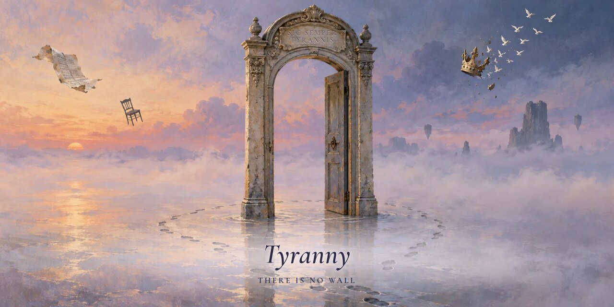

  <a href="https://tyranny.me"><picture><source media="(prefers-color-scheme: dark)" srcset="https://shieldcn.dev/badge/site-tyranny.me.svg?variant=outline&amp;size=sm&amp;font=geist&amp;logo=googlechrome&amp;mode=dark"></picture></a>
  <a href="https://x.com/tyrannyme"><picture><source media="(prefers-color-scheme: dark)" srcset="https://shieldcn.dev/x/follow/tyrannyme.svg?variant=outline&amp;size=sm&amp;font=geist&amp;mode=dark"></picture></a>

<i>Every gate guards something somebody decided you couldn’t have. Tyranny builds the opposite: tools that hand the power back.</i>

### Found in the drift

**[Minv](https://github.com/tyrannyme/minv)**: VS Code, minus everything you never open. Explorer, search, the terminal, Git and up to 256 submodules. Free, for Linux and Windows. [minv.tyranny.me](https://minv.tyranny.me)

**[Automedia](https://github.com/tyrannyme/automedia)**: HTML in, video out. A local engine that turns HTML, CSS and JavaScript into stills, animations and video. No render farm, no subscription, nobody’s permission. [automedia.tyranny.me](https://automedia.tyranny.me)

There’s also a blank sign waiting at [tyranny.me](https://tyranny.me). Paint it. Nobody has to approve it.

<b>SIC SEMPER TYRANNIS</b> · thus always to tyrants, and to every gate that guards nothing

